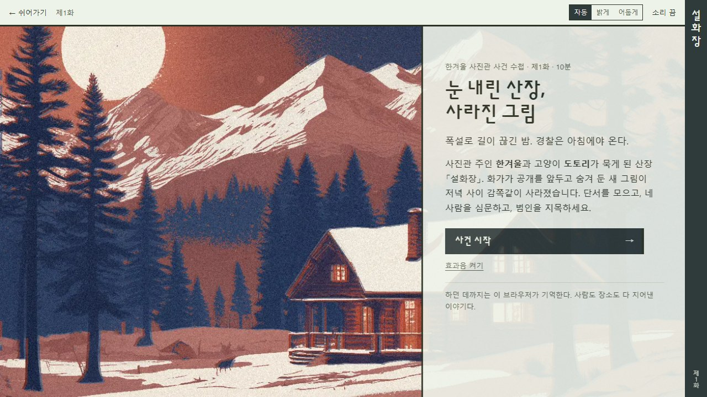

# HanGyeoul Studio (한겨울 사진관)

**A free Korean mystery game for Windows.** Play a photo-studio detective and her cat: search the scene, question the suspects, line up the clues and name the culprit. About 10–20 minutes per case. The game is in Korean.

**Install:** download `HanGyeoulStudio.exe` from [Releases](https://github.com/swbins/hangyeoul/releases/latest) (Windows 10/11, single file, no installer).

[한국어 설명 ↓](#한국어)

---

## 한국어

**한겨울 사진관 — 사진관 탐정의 추리 게임**

사진관 탐정 한겨울과 고양이 도토리가 되어 장소를 살피고, 사람들을 심문하고, 단서를 맞춰 범인을 지목합니다. 한 사건에 10~20분.

- 시즌 1 열 사건 + 번외편 열 편, 시즌 2 첫 사건. 처음부터 다 열려 있고, 번외편은 본편을 별 다섯 개로 풀면 열립니다.
- 금고 다이얼 · 사진 속 숨은 손 · 이삿짐 목록 같은 퍼즐. 막히면 도토리가 힌트를 줍니다.
- 진행은 저절로 저장돼서, 창을 닫아도 하던 데서 이어 합니다.

사람도 장소도 사건도 다 지어낸 이야기입니다.

## 받기

**[최신 판 받기 (Releases)](https://github.com/swbins/hangyeoul/releases/latest)** — `HanGyeoulStudio.exe` 하나, 설치 과정 없음

- **Windows 10 / 11** (창은 Microsoft Edge 로 열립니다 — 기본으로 깔려 있음)
- 처음 실행할 때 **「Windows의 PC 보호」** 창이 뜰 수 있습니다. 코드 서명을 하지 않은 개인 앱이라 그렇습니다.
  **「추가 정보」 → 「실행」** 을 누르면 열립니다.
- 받은 파일 확인(PowerShell): `Get-FileHash .\HanGyeoulStudio.exe` → 릴리스 노트의 SHA256 과 같으면 그대로 받은 것입니다.

## 저장 · 업데이트

- 진행 기록은 **이 PC 안**(`%LOCALAPPDATA%\HanGyeoulStudio`)에만 남습니다. 가입 · 로그인 · 광고 · 사용 통계가 없습니다.
- 게임은 전부 앱 안에 들어 있어서 인터넷이 없어도 처음부터 끝까지 할 수 있습니다.
- 인터넷이 되면, 켤 때 사이트(swbins.github.io)에서 새 사건 · 고친 내용을 확인해 **바뀐 파일만** 받아 둡니다. 다음에 켤 때부터 새 내용이 보입니다. exe 를 다시 받을 필요는 없습니다.
- 지우려면 실행 파일과 위 폴더를 지우면 됩니다.

- [개인정보 처리 안내](PRIVACY.md)
- [이용 약관](TERMS.md)
- [서드파티 고지](THIRD-PARTY-NOTICES.md)

## 문의 · 버그 알리기

[Issues](https://github.com/swbins/hangyeoul/issues) 에 남겨 주세요. 소개 페이지: https://swbins.github.io/hangyeoul/

---

이 저장소에는 실행 파일과 안내 문서만 있습니다(소스 비공개).
